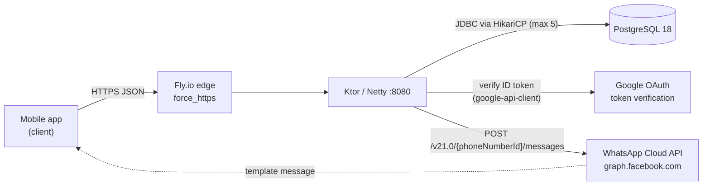
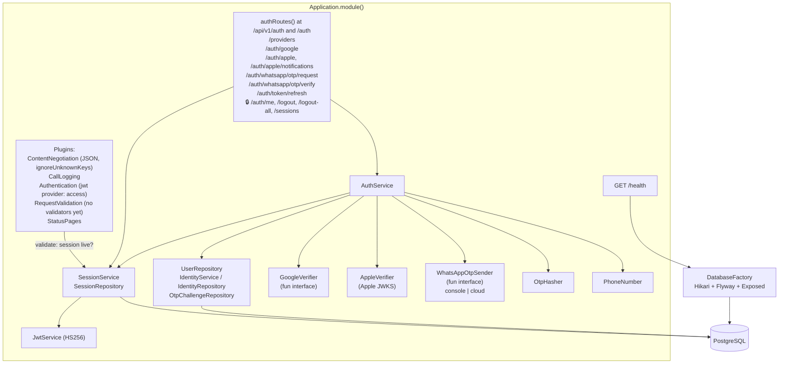
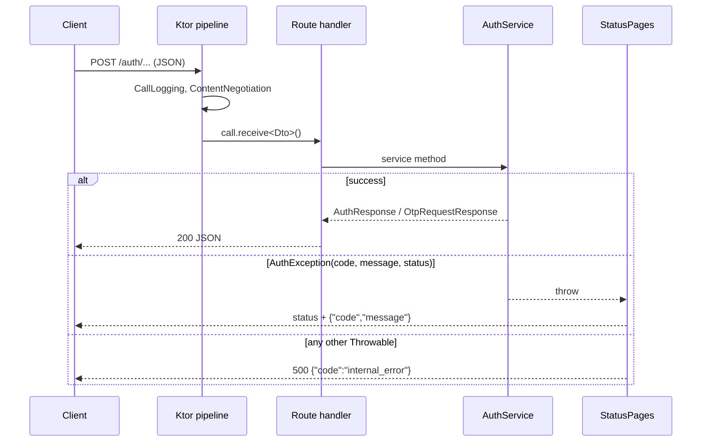
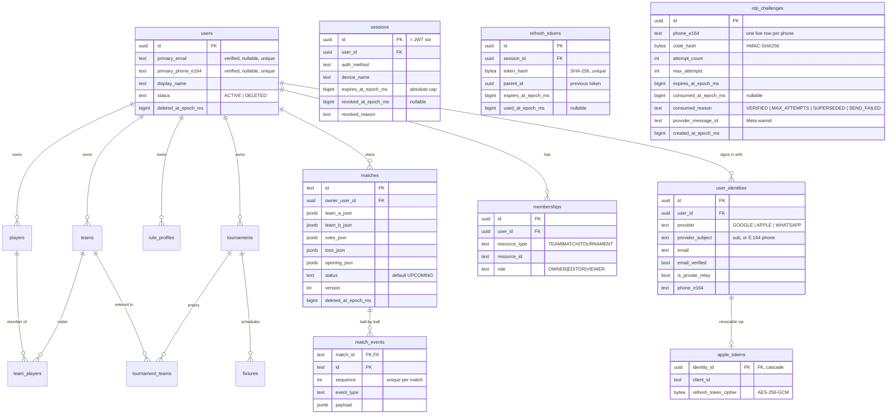
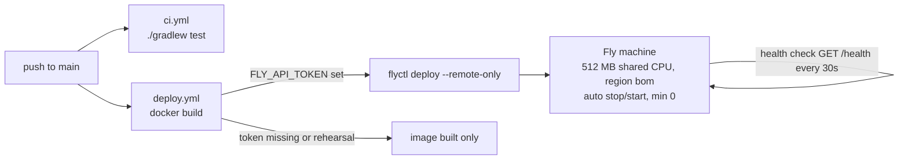

# Architecture

## Overview

One stateless Ktor (Netty) process sits in front of PostgreSQL. It does two jobs today:

1. **Identity**: it exchanges a Google ID token, or a WhatsApp-delivered OTP, for a session: a 15-minute server-signed JWT plus a rotating refresh token.
2. **Schema foundation**: Flyway creates the tables a mobile scoring app will sync to (players, teams, tournaments, matches, ball events, memberships). No sync or CRUD endpoints exist yet.

There is no cache, message queue, background worker, LLM or vector store.

## Components

| Component | File | Responsibility |
|---|---|---|
| Entry point | `Application.kt` | `main()` starts Netty on `0.0.0.0:8080`. `module()` connects the DB, wires auth, installs plugins and maps errors. |
| `AuthDependencies` | `Application.kt` | Holds `AuthConfig`, `GoogleVerifier` and `WhatsAppOtpSender`. `fromEnv()` builds the real ones, and tests pass fakes. |
| `DatabaseConfig` | `DatabaseConfig.kt` | Turns `DATABASE_URL` (JDBC or `postgres://` form), or `DB_HOST`/`DB_PORT`/`DB_NAME`, plus the user/password env vars into JDBC settings. Defaults to `localhost:5433/cricket_scoring`. |
| `DatabaseFactory` | `DatabaseFactory.kt` | Builds a Hikari pool, runs `Flyway.migrate()` from `classpath:db/migration`, calls `Database.connect`, and provides `ping()` (`SELECT 1`). |
| Tables | `Tables.kt`, `JsonbColumn.kt` | Exposed mappings for every table, plus a custom `JSONB` column type stored as a `String`. |
| `AuthService` | `auth/AuthService.kt` | The sign-in flows: user lookup, linking and creation, OTP lifecycle, JWT response. |
| `UserRepository` | `auth/UserRepository.kt` | Queries on `users`. First-login inserts use `INSERT ... ON CONFLICT DO NOTHING`, so concurrent sign-ins resolve to one user. |
| `OtpChallengeRepository` | `auth/OtpChallengeRepository.kt` | Queries on `otp_challenges`: per-phone advisory lock, send history for limits, and the single-statement attempt counter. Functions join the caller's transaction. |
| `JwtService` | `auth/JwtService.kt` | Mints 15-minute HS256 access tokens (`iss`, `aud`, `sub`=user id, `sid`=session id, `amr`, `jti`, `iat`, `exp`; no PII) and builds the verifier for the Ktor `jwt("access")` provider, using the injected clock. |
| `SessionService` | `auth/SessionService.kt` | Starts sessions on sign-in, rotates refresh tokens with reuse detection and a 10 s retry grace, logout / logout-all / list / revoke, and the live-session check the auth provider runs on every request. |
| `SessionRepository` | `auth/SessionRepository.kt` | Queries on `sessions` and `refresh_tokens`. `findTokenForUpdate` takes a row lock so parallel refreshes of one token run one at a time. |
| `GoogleVerifier` | `auth/GoogleVerifier.kt` | Checks the ID token's audience against `GOOGLE_CLIENT_IDS` and requires a verified email. Without a client id, every call fails with 503. |
| `AppleVerifier` | `auth/AppleVerifier.kt` | `AppleTokenVerifier` checks Apple identity tokens and notification payloads: key by `kid` from Apple's JWKS (cached 24 h, rate-limited refetch), RS256, `iss`, `aud` in `APPLE_CLIENT_IDS`, `exp` (60 s leeway), and SHA-256 nonce match. Without client IDs every call is `503 apple_not_configured`. |
| `AccountService` | `auth/AccountService.kt` | `DELETE /auth/me`: revokes stored Apple tokens (best effort), then one transaction under the user-row lock revokes and scrubs sessions, deletes identities and OTP history, soft-deletes owned cricket data, deletes memberships and turns the user into a tombstone. |
| `AppleTokenClient` | `auth/AppleTokenClient.kt` | Apple `/auth/token` code exchange and `/auth/revoke`, with an ES256 `client_secret` signed by the `.p8` key; `TokenCipher` encrypts stored tokens (AES-256-GCM). Disabled unless all four Apple revocation settings are set. |
| `OtpGuard` | `auth/OtpGuard.kt` | WhatsApp rollout flag (off / allowlist / on, minimum app version), country allowlist, per-IP send and verify limits, per-phone block after repeated wrong codes, and the global daily budget, using `rate_limit_buckets`. |
| `AuthEventRecorder` | `auth/AuthEventRecorder.kt` | Writes `auth_events` (best effort) and computes the phone HMAC used in events and bucket keys. |
| `WhatsAppWebhook` | `auth/WhatsAppWebhook.kt` | `/webhooks/whatsapp`: Meta handshake, `X-Hub-Signature-256` check, forward-only `delivery_status` updates. |
| `IdentityService` | `auth/IdentityService.kt` | Maps provider identities to accounts: find-or-create on sign-in (by identity, then verified contact, then new), explicit link and unlink. Each operation is one transaction under a per-identity advisory lock; unlink locks the user row. |
| `IdentityRepository` | `auth/IdentityRepository.kt` | Queries on `user_identities`. |
| `WhatsAppOtpSender` | `auth/WhatsAppOtpSender.kt` | `console` logs the code. `cloud` sends a WhatsApp template message through the Meta Graph API v21.0. |

## Request lifecycle and error handling

`StatusPages` mappings (from `Application.kt`):

| Exception / status | HTTP | `code` |
|---|---|---|
| `RequestValidationException` | 400 | `validation_error` |
| `authenticate("access")` challenge (no/invalid/expired token, dead session) | 401 | `unauthorized` |
| `AuthException` | `cause.status` | `cause.code` |
| `AuthException` with `retryAfterSeconds` | `cause.status` + `Retry-After` header | `cause.code` |
| `BadRequestException` (malformed JSON, missing field) | 400 | `validation_error` |
| any other `Throwable` | 500 | `internal_error` |
| unmatched route (404) | 404 | `not_found` |

## Data model

Design notes, from the migrations and the `Tables.kt` comment:

- The tables mirror the **device document model**. Domain ids are `TEXT`, so the server can keep the ids the app generates. Nested structures (rules, squads, toss, opening, event payloads) stay as `JSONB` instead of being normalized.
- Every syncable table has `version`, `created_at_epoch_ms`, `updated_at_epoch_ms`, `deleted_at_epoch_ms` and an `(owner_user_id, updated_at_epoch_ms)` index. That layout suits "changes since" sync queries and soft deletes. **No sync logic is implemented yet.**
- Sign-in methods live in `user_identities`, not on `users`: `UNIQUE (provider, provider_subject)` stops one Google account or phone from opening two accounts, and `UNIQUE (user_id, provider)` allows one of each per account. `IdentityService` refuses to remove an account's last identity.
- `fixtures.team_a_id`, `team_b_id` and `match_id`, plus `matches.tournament_id`, `fixture_id` and `rule_profile_id`, are plain `TEXT` with **no** foreign keys.
- `memberships` models sharing (owner/editor/viewer on a team, match or tournament). No code reads it yet.

## Deployment

- The `Dockerfile` is two stages: `eclipse-temurin:17-jdk` runs `./gradlew installDist`, then the result runs on `eclipse-temurin:17-jre` with the entrypoint `/app/bin/CricketScoringBackend`.
- Fly scales to zero (`min_machines_running = 0`), so the first request after an idle period pays the JVM start-up plus Flyway check.
- Fly secrets supply `DATABASE_URL` and the auth env vars. `fly.toml` contains none of them.
